<div dir="rtl">

<p align="center">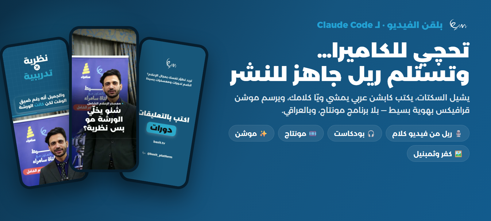</p>

<p align="center"><b>تحچي للكاميرا… وتستلم ريل عمودي جاهز للنشر.</b><br>
يشيل السكتات، يكتب كابشن عربي يمشي ويّا كلامك، ويرسم موشن قرافيكس بهوية بسيط — بلا برنامج مونتاج، وفيديوك ما يطلع من جهازك.</p>

<p align="center"><a href="#install">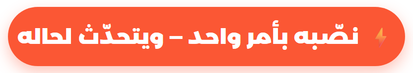</a></p>

<a id="install"></a>

## ⚡ نصّبه بأمر واحد — 3 خطوات

<p align="center">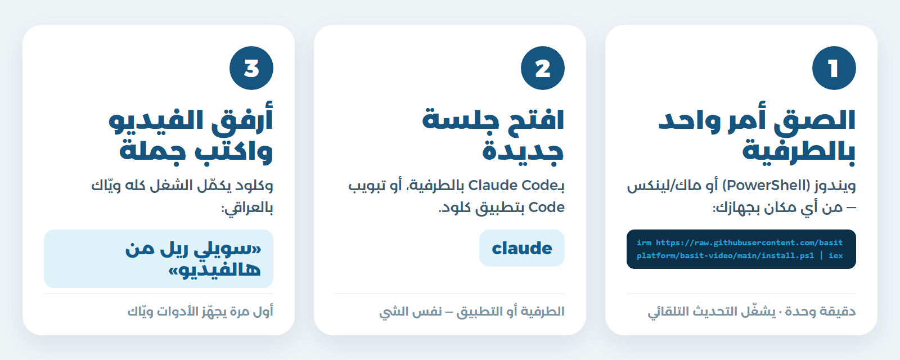</p>

### 1️⃣ الصق الأمر بالطرفية — من أي مكان بجهازك

ما يحتاج تنزّل ملف ولا تحطه بمكان معيّن. افتح الطرفية والصق السطر حسب جهازك:

**ويندوز** — افتح **PowerShell** والصق:

<div dir="ltr">

```powershell
irm https://raw.githubusercontent.com/basitplatform/basit-video/main/install.ps1 | iex
```

</div>

**ماك ولينكس** — افتح **Terminal** والصق:

<div dir="ltr">

```bash
curl -fsSL https://raw.githubusercontent.com/basitplatform/basit-video/main/install.sh | bash
```

</div>

السكربت يسوّي كلشي لحاله: يتأكد إن Claude Code منصّب، ينصّب البلقن، **يشغّل التحديث التلقائي**، ويعطّل أي بلقن فيديو ثاني بنفس السكلات حتى ما تتكرر.

> 💡 **طلعلك إن Claude Code مو منصّب؟** نصّبه أول (أمر واحد، يطلعلك بنفس الرسالة)، وبعدين أعد أمر التنصيب.

### 2️⃣ افتح جلسة جديدة

بـ**Claude Code** بالطرفية (اكتب `claude`)، أو بتبويب **Code** بتطبيق كلود للديسكتوب.

### 3️⃣ أرفق الفيديو واكتب جملة

> «سويلي ريل من هالفيديو»

بأول مرة كلود يفحص الأدوات اللي يحتاجها (ffmpeg، بايثون، كروم) ويجهّزها ويّاك، وبعدها يمشي بالشغل خطوة خطوة ويخبرك وين وصل.

### 🔄 التحديثات توصلك لحالها
كل ما ينزل إصدار جديد، Claude Code يجيبه بأول جلسة تفتحها. ما تحتاج تسوّي شي.

<details><summary>تنصيب يدوي (بدون السكربت)</summary>

<div dir="ltr">

```bash
claude plugin install basit-video --marketplace basitplatform/basit-video
```

</div>

وبعدين شغّل التحديث التلقائي مرة وحدة: افتح `claude` ← `/plugin` ← **Marketplaces** ← **basit** ← **Enable auto-update**.
</details>

---

## 🎬 داخل البلقن — 5 سكلات، كل وحدة لشغلة

<table><tr>
<td width="20%" align="center" valign="top">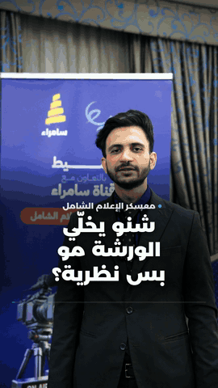<br><b>🎙️ ريل من فيديو كلام</b><br><sub>سكتات أقل · كابشن على الكلمة · هوك وموشن</sub></td>
<td width="20%" align="center" valign="top">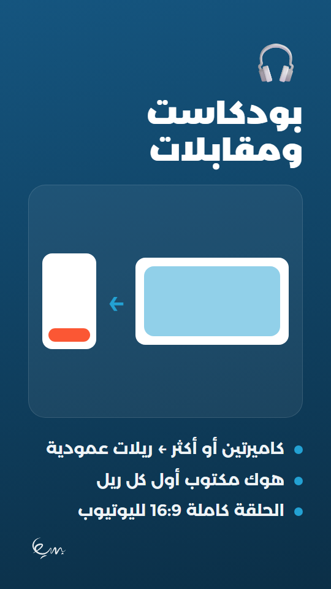<br><b>🎧 بودكاست ومقابلات</b><br><sub>كاميرتين ← ريلات · الحلقة كاملة 16:9</sub></td>
<td width="20%" align="center" valign="top">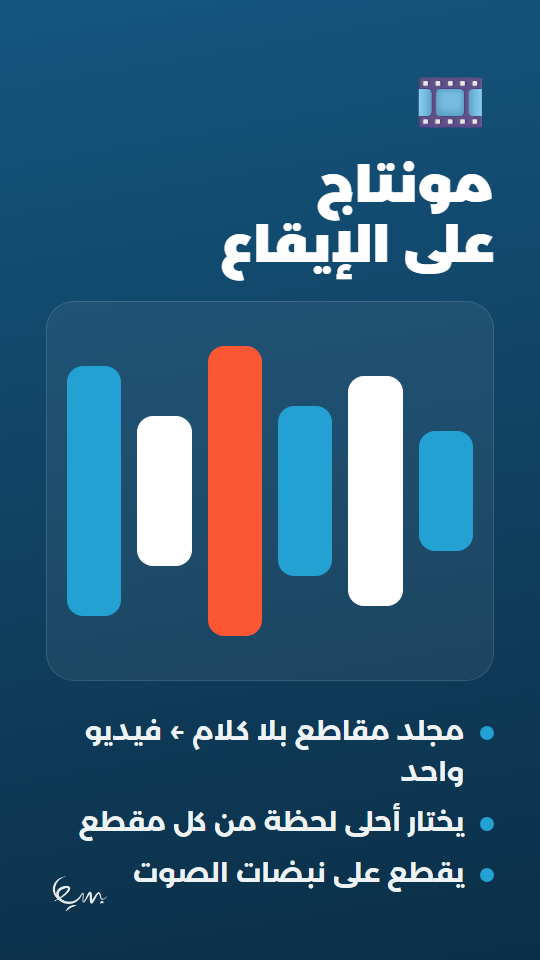<br><b>🎞️ مونتاج مقاطع</b><br><sub>مجلد بلا كلام ← فيديو على الإيقاع</sub></td>
<td width="20%" align="center" valign="top">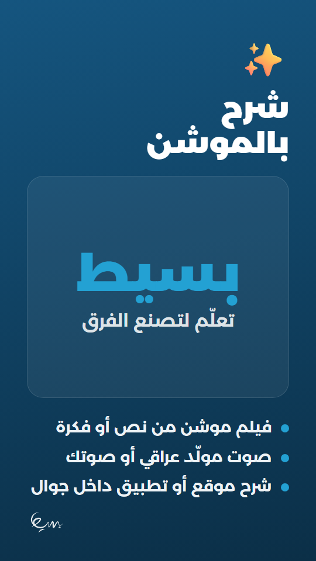<br><b>✨ شرح بالموشن</b><br><sub>فيلم من نص · صوت عراقي مولّد</sub></td>
<td width="20%" align="center" valign="top">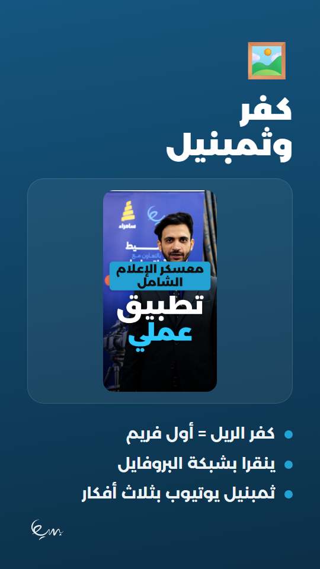<br><b>🖼️ كفر وثمبنيل</b><br><sub>ينقرا بالجوال · ثمبنيل يوتيوب</sub></td>
</tr></table>

<sub>الريل أعلاه طلّعه البلقن فعلاً من فيديو بمعسكر الإعلام الشامل: هوك مكتوب، لوحة «نظرية ✕ تدريبية»، وكرت ختام بسيط.</sub>

## 🗣️ يحچي عراقي — وبأي لهجة تريدها

<p align="center">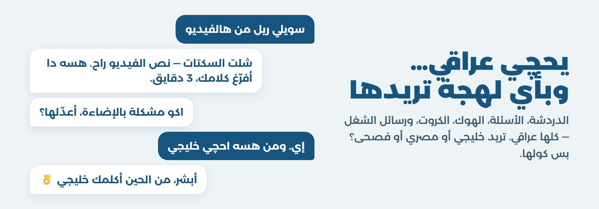</p>

- **كلشي عراقي:** الدردشة، الأسئلة، رسائل الشغل، قائمة الخطوات، الهوك، الكروت، وسكربت الموشن.
- **الكابشن يبقى كلام المتحدث نفسه** بلهجته — ما يتبدّل.
- **تريد لهجة ثانية؟** كول «احچي خليجي» أو «سوّيه بالمصري» أو «أريد فصحى»، ويبدّل فوراً.

## 🎨 بنك الحركات — 100 حركة بهوية بسيط

<p align="center">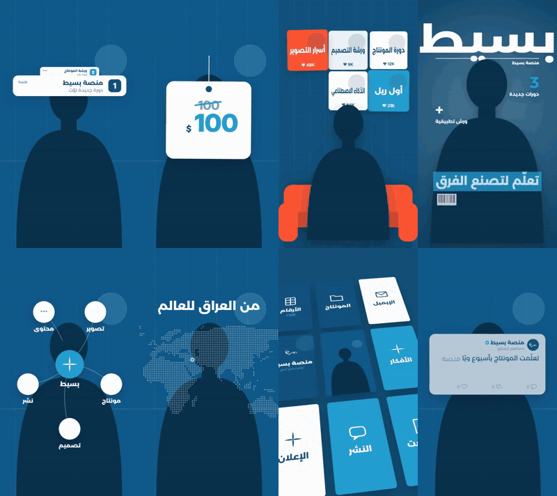</p>

كل فيديو ياخذ لوحة حركات خاصة بيه: 3 حركات أساسية يدور حولها، ولمسات للحظات المهمة — وكلها بألوان بسيط وخط Montserrat Arabic.

<details><summary><b>الـ100 كلها</b> (اضغط تفتح)</summary>
<p align="center">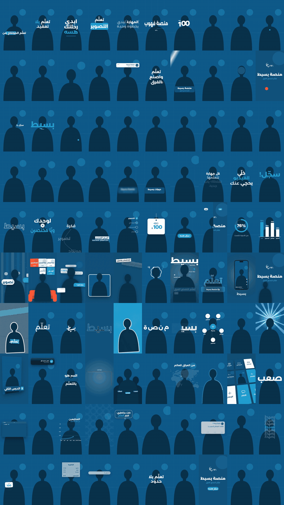</p>
</details>

## 🖼️ كفر ينقرا بالجوال

<p align="center">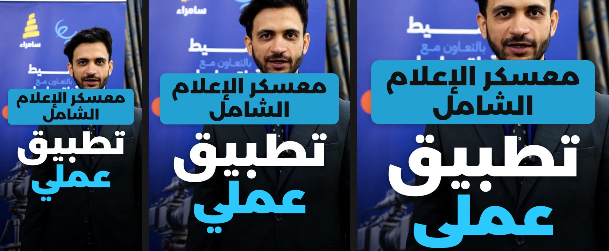</p>

الكفر يصير **أول فريم** بالفيديو، وكل المهم داخل مربع 1:1 حتى ينقرا بشبكة البروفايل — والعنوان على الصدر، مو على الوجه.

## 💬 شنو تكوله

| تريد | كول |
|---|---|
| ريل من فيديو تحچي بيه | «سويلي ريل من هالفيديو» · «شيل السكتات» · «ركّبلي كابشن» |
| ريلات من بودكاست أو مقابلة | «كصّلي ريلات من الحلقة» · «الحلقة كاملة بالعرض» |
| مونتاج مقاطع بلا كلام | «سويلي مونتاج من هالمقاطع» |
| فيلم موشن | «سويلي فيديو موشن من هالنص» · «اشرح هالموقع بفيديو» |
| كفر أو ثمبنيل | «سويلي كفر» · «سويلي ثمبنيل» |
| تعديل | «شيل هاي الجملة» · «كبّر الكابشن» · «غيّر الختام» |

## 🔧 المتطلبات

- **Claude Code** (الطرفية أو تطبيق الديسكتوب) — يفضّل موديل Opus.
- **Python** و**ffmpeg** و**Node.js** و**Chrome** أو **Edge** — كلود يفحصها بأول مرة ويجهّز الناقص ويّاك.
- **ويندوز:** يشتغل كامل، والتفريغ بـ`faster-whisper` الخفيف. رصد الوجه وقص الشخص يشتغلن على الماك بس.

## 🔒 الخصوصية

فيديوهاتك تنشغل على جهازك. البلقن ما يرفعها لأي مكان، وما ينشر شي — التسليم ملف بس.

## ❓ إذا صار شي

- **«claude» مو معروف بالطرفية:** Claude Code مو منصّب، أو سكّر النافذة وافتح وحدة جديدة بعد التنصيب.
- **السكلات مكررة:** عندك بلقن فيديو ثاني بنفس السكلات — أمر التنصيب يعطّله لحاله، أو عطّله من `/plugin`.
- **ما وصلني التحديث:** افتح جلسة جديدة، أو شغّل `claude plugin update basit-video@basit`.

---

<p align="center"><a href="https://basit.tv">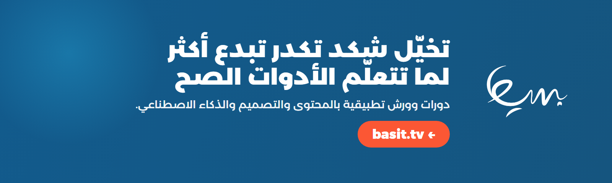</a></p>

<p align="center">
🌐 <a href="https://basit.tv">basit.tv</a> · 📸 <a href="https://www.instagram.com/basit_platform/">إنستغرام</a> · 🔵 <a href="https://facebook.com/basit.platform/">فيسبوك</a>
</p>

---

## 🛠️ للمطوّرين

<details><summary>نشر تحديث، الهوية، المعاينات، والصور</summary>

**نشر تحديث** (بعد أي تعديل):

<div dir="ltr">

```bash
python tools/release.py            # 3.5.0 → 3.5.1
python tools/release.py minor      # 3.5.0 → 3.6.0
```

</div>

يرفع رقم الإصدار، يفحص البلقن، ويرفعه هنا — والمستخدمين يوصلهم لحاله. ⚠️ لازم يتغيّر الرقم حتى يوصل التحديث، و`release.py` يسويها.

**الهوية:** كل الإعدادات البصرية (الألوان، خط Montserrat Arabic، الشعار، الروابط، كرت الختام) بـ`video-ad-editor/brand/basit/brand.json`، و`scripts/00_brand.py` يركّبها بكل فيديو.

**معاينات بنك الحركات:** `python tools/previews/make.py` يرسم الـ100 بهوية بسيط (`--sheet` ورقة مراجعة · `--only 15,46` حركات معيّنة).

**صور هالصفحة:** `python tools/landing/make_assets.py <مجلد لقطات ريل>` يصمّمها من جديد بـ`assets/`.

**سكربت تنصيب ويندوز:** عدّل `install.src.ps1` (عربي مقروء)، و`tools/make_installer.py` يولّد `install.ps1` (أحرف إنقليزية بس، حتى يشتغل على PowerShell 5.1).

**ملف `.plugin` بلا نت:** `python tools/build.py` ← `dist/basit-video.plugin` للرفع اليدوي بتطبيق كلود (ما يتحدّث لحاله).
</details>

## 📜 الحقوق والتراخيص

- **المشروع:** رخصة MIT، بحقوق منصة بسيط على التعديلات والتطويرات. إشعار الحقوق الأصلي محفوظ داخل `LICENSE` لأن الرخصة تفرض بقاءه.
- **الخطوط:** خط منصة بسيط الرسمي **Montserrat Arabic** بكل أوزانه (SIL OFL 1.1)، وباقي الخطوط برخصها OFL (`video-ad-editor/motion/fonts/LICENSES.txt`).
- **المكونات التقنية:** مكتبة three.js برخصة MIT.
- **مصادر الحركات:** مراجع إلهام، والحركات مكتوبة من جديد بهوية بسيط (`video-ad-editor/motion/moves/CREDITS.md`).

</div>
